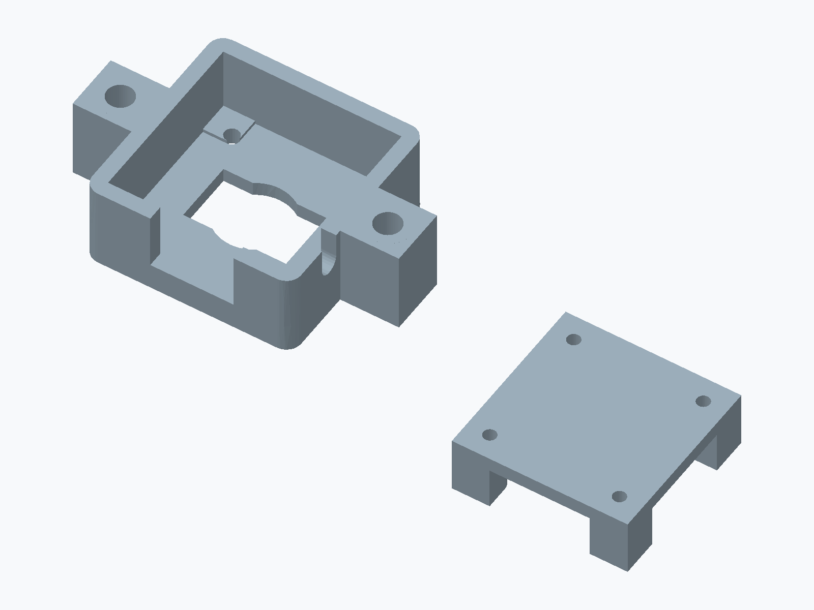
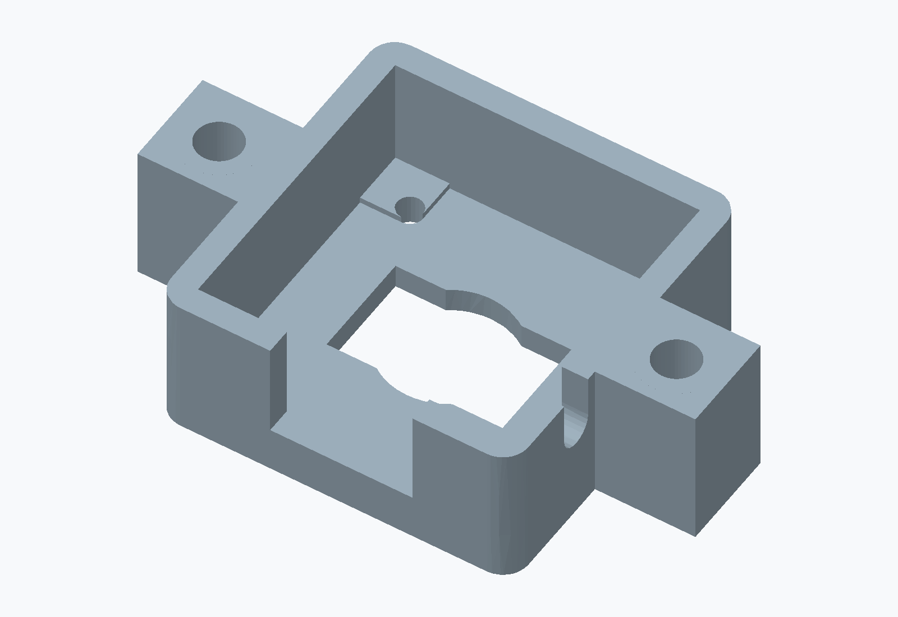
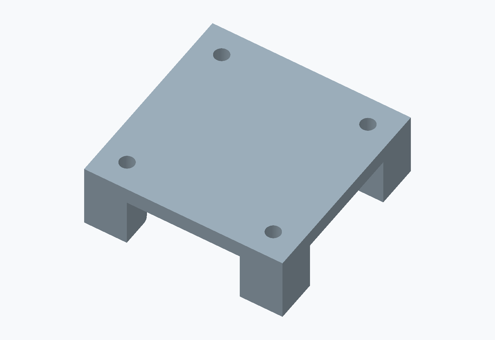

# OV9281 Camera Module Case

A 3D-printable case designed to house the PCB of the OV9281 camera module used in my four-camera motion-capture system. It accompanies the [OV9281 Camera Module 3D Model](https://github.com/jaypark0115/ov9281-camera-module-3d-model), which records the module's mechanical shape and dimensions.

The case body provides the PCB seating area, lens opening, and side mounting tabs. A separate rear cover closes the back of the housing.

## Model downloads

| Part | STL file |
| --- | --- |
| Case body | [Camera_mount_almost_final.stl](models/stl/Camera_mount_almost_final.stl) |
| Rear cover | [BackV3.stl](models/stl/BackV3.stl) |

The models use millimetres. Import the STL files into your slicer and set the print orientation and settings for your printer.

## Rendered views

| Case body | Rear cover |
| --- | --- |
|  |  |

These views are rendered directly from the STL geometry. The overview shows the two parts separately.

## Related project

- [OV9281 Camera Module 3D Model](https://github.com/jaypark0115/ov9281-camera-module-3d-model)
